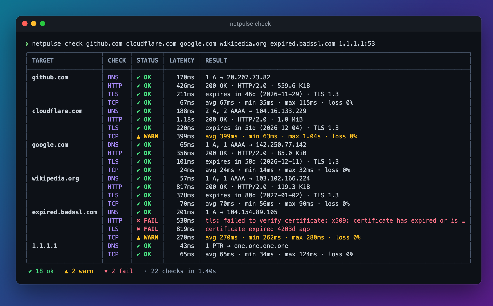
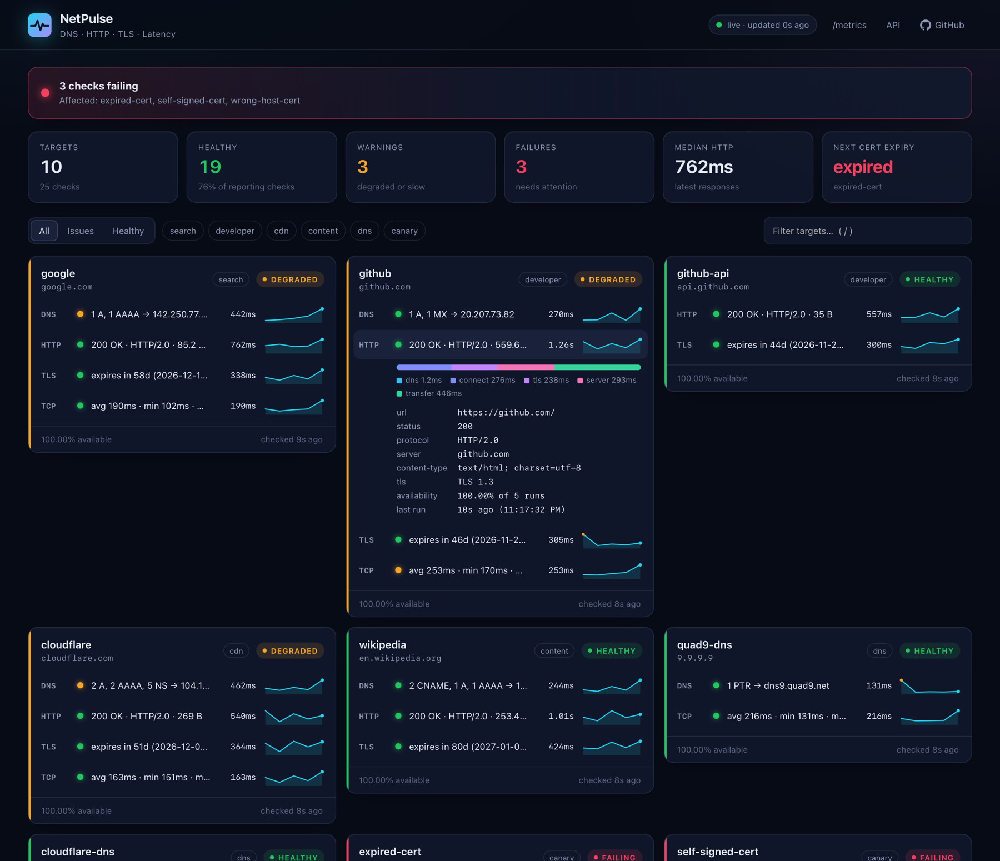
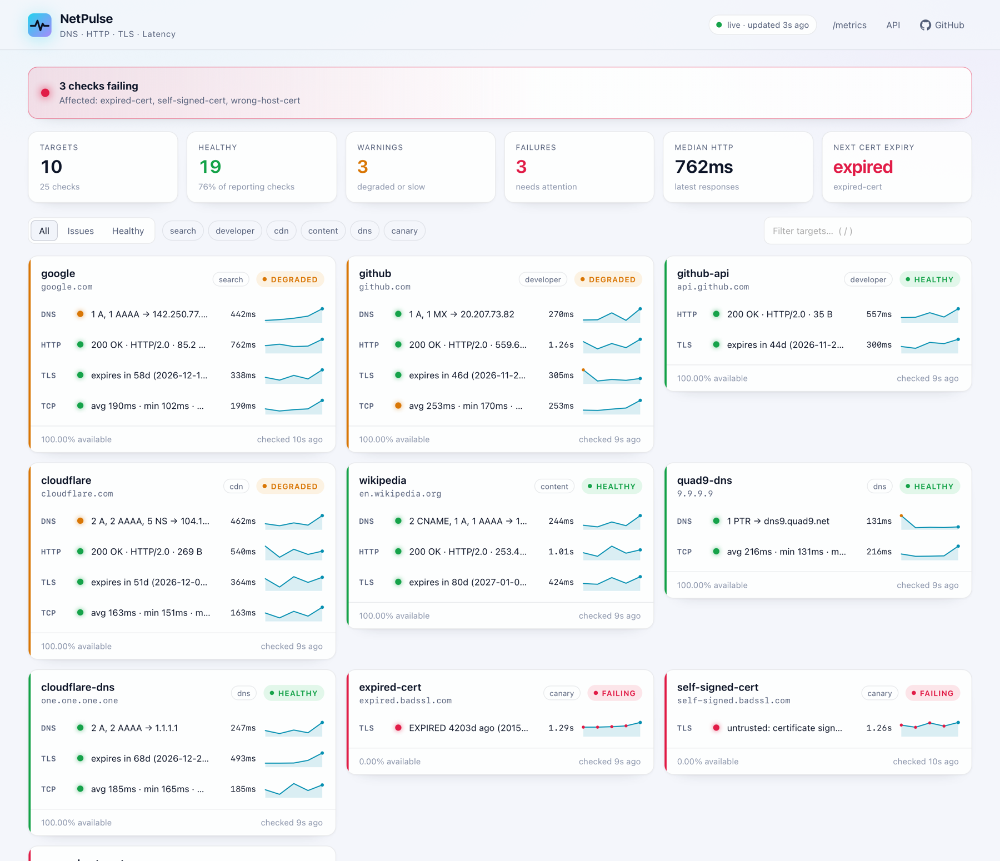
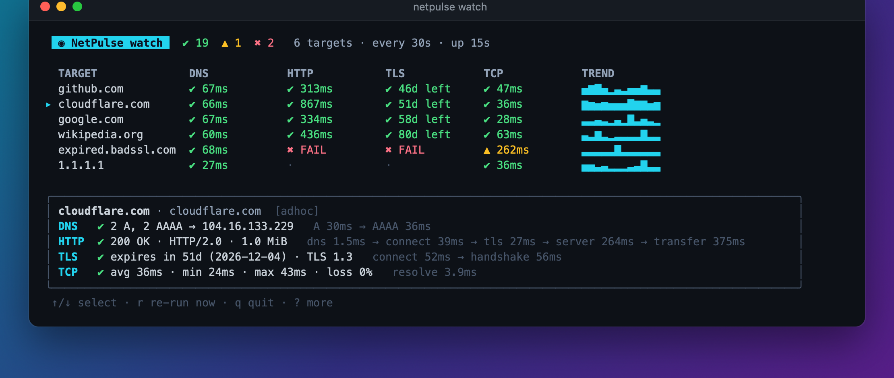
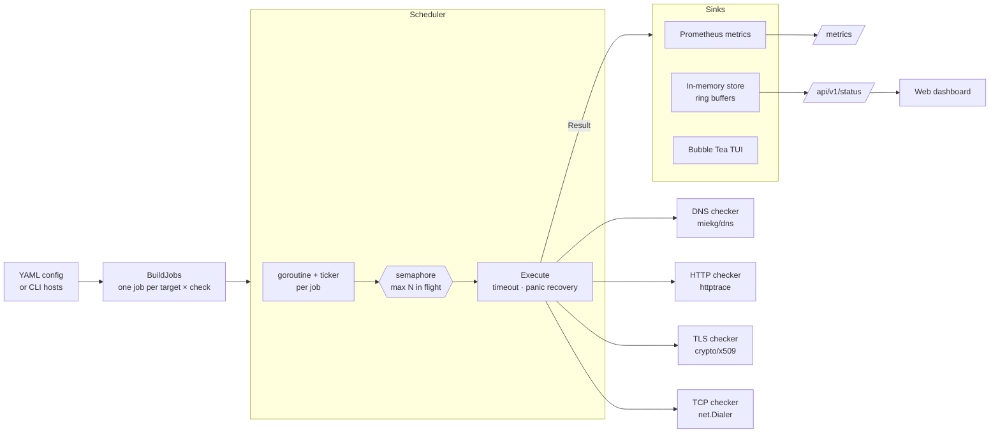

<div align="center">


# NetPulse

**A fast, concurrent network health checker written in Go.**<br>
DNS · HTTP · TLS certificate expiry · TCP latency — as a CLI, a live terminal dashboard, or a Prometheus exporter with a built-in web UI.

[](https://github.com/agarwala-ayush/netpulse/actions/workflows/ci.yml)
[](https://goreportcard.com/report/github.com/agarwala-ayush/netpulse)
[](go.mod)
[](LICENSE)
[](docs/METRICS.md)
[](https://github.com/agarwala-ayush/netpulse/pkgs/container/netpulse)

[Quick start](#-quick-start) · [Features](#-features) · [Usage](#-usage) · [Metrics](#-prometheus-metrics) · [Architecture](#-architecture) · [Deploy](#-deployment) · [Docs](docs/)



</div>

---

## ✨ Features

| | |
|---|---|
| 🌐 **DNS** | Queries any record type (A, AAAA, CNAME, MX, TXT, NS, CAA, PTR…) against the system or a chosen resolver; reports RCODE, TTLs and per-query RTT. Retries lost UDP datagrams and falls back to TCP on truncation. Optional `expect` assertions catch hijacked or drifting records. |
| 🔗 **HTTP(S)** | Full request timing breakdown via `httptrace` — **DNS → connect → TLS → server (TTFB) → transfer** — plus status-code and body assertions, custom headers/methods, redirect control and a 1 MiB body cap. |
| 🔐 **TLS** | Inspects the presented chain even when it's broken: expiry of the *earliest-expiring* cert, issuer, SANs, protocol and cipher; verifies trust and hostname separately so you learn *why* it fails (expired / self-signed / wrong host). Warn and critical thresholds in days. |
| ⏱️ **Latency** | TCP-connect "ping" (no root or `CAP_NET_RAW` needed): min / avg / max / jitter / loss over N samples, with detection of SYN retransmissions hiding inside "successful" connects. |
| ⚡ **Concurrency** | Hundreds of hosts in parallel behind a bounded worker pool, per-check timeouts, panic isolation and jittered scheduling to avoid thundering herds. |
| 📈 **Observability** | Prometheus/OpenMetrics `/metrics` with histograms, state-set status, cert-expiry timestamps and phase durations. Ships with a Grafana dashboard and alert rules. |
| 🖥️ **Three interfaces** | `check` (one-shot, Nagios exit codes, table/JSON/Markdown), `watch` (live full-screen TUI), `serve` (exporter + web dashboard + JSON API). |
| 🔧 **Ops-ready** | YAML config with strict validation and `${ENV}` expansion, hot reload on `SIGHUP`, `/healthz` + `/readyz`, structured `slog` logging, graceful shutdown, ~17 MB distroless image, hardened systemd unit, Kubernetes manifests. |

## 🚀 Quick start

```bash
# Install (Go 1.26+)
go install github.com/agarwala-ayush/netpulse/cmd/netpulse@latest

# Check some hosts right now — no config needed
netpulse check github.com cloudflare.com https://example.org/health

# Live terminal dashboard
netpulse watch github.com cloudflare.com google.com

# Generate a config, then run the exporter + web dashboard on :9469
netpulse init && netpulse serve
```

Or with Docker:

```bash
docker run --rm -p 9469:9469 ghcr.io/agarwala-ayush/netpulse:latest
# open http://localhost:9469
```

Or the full stack — NetPulse + Prometheus + Grafana with dashboards and alerts pre-provisioned:

```bash
make stack-up   # dashboard :9469 · Prometheus :9090 · Grafana :3000
```

## 🖼️ Screenshots

<table>
<tr>
<td width="50%"><b>Web dashboard</b> (<code>netpulse serve</code>)<br></td>
<td width="50%"><b>Light theme</b> (follows the OS setting)<br></td>
</tr>
<tr>
<td colspan="2"><b>Live terminal UI</b> (<code>netpulse watch</code>)<br></td>
</tr>
</table>

## 📖 Usage

```text
netpulse check    [hosts...]   Run every check once, print results, exit with a status code
netpulse watch    [hosts...]   Live terminal dashboard, re-running checks continuously
netpulse serve    [hosts...]   Exporter: /metrics, web dashboard, JSON API, health probes
netpulse init     [path]       Write an annotated example config
netpulse validate -c file      Validate a config and show what it would check
netpulse version  [--json]     Build information
```

Hosts on the command line can be bare names, URLs or `host:port`:

| Argument | Checks enabled |
|---|---|
| `github.com` | DNS, HTTPS `GET /`, TLS :443, TCP :443 |
| `https://api.example.com:8443/health` | DNS, HTTP to that exact URL, TLS :8443, TCP :8443 |
| `http://intranet.local` | DNS, HTTP, TCP :80 (no TLS) |
| `db.internal:5432` | DNS, TCP :5432 |

Narrow it down with `--checks dns,tls`, pick a resolver with `--dns-server 1.1.1.1:53`, or set `--timeout 3s`.

### Exit codes (scripting & CI)

`netpulse check` follows the **Nagios plugin convention**, so it drops straight into cron, CI pipelines and existing monitoring:

| Code | Meaning |
|---|---|
| `0` | all checks OK |
| `1` | WARNING: something is slow, or a certificate expires soon |
| `2` | CRITICAL: at least one check failed |
| `3` | UNKNOWN: invalid usage or configuration |

```bash
# Fail a deploy pipeline if anything is critical
netpulse check -c prod.yaml || [ $? -eq 1 ]

# Post a Markdown report to a GitHub Actions job summary
netpulse check -c netpulse.yaml -o markdown >> "$GITHUB_STEP_SUMMARY"

# Machine-readable output for jq
netpulse check -c netpulse.yaml -o json | jq '.results[] | select(.status != "ok") | .target'
```

## ⚙️ Configuration

```yaml
interval: 30s          # how often each check runs
timeout: 10s           # per-check deadline
concurrency: 16        # max checks in flight

targets:
  - name: api
    host: api.example.com
    group: production
    dns:
      types: [A, AAAA]
      expect: ["203.0.113.10"]
    http:
      url: https://api.example.com/healthz
      expect_status: [200]
      body_contains: '"status":"ok"'
      headers:
        Authorization: "Bearer ${API_TOKEN}"   # expanded from the environment
    tls:
      warn_days: 21
      crit_days: 7
    tcp:
      count: 5
```

A check is enabled by being present (`tls: {}` uses all defaults). Unknown keys are **rejected**, so a typo can never silently weaken an assertion. See **[docs/CONFIGURATION.md](docs/CONFIGURATION.md)** for every option, or run `netpulse init` for an annotated file.

## 📈 Prometheus metrics

| Metric | Type | Description |
|---|---|---|
| `netpulse_check_up` | gauge | 1 if the check is not failing |
| `netpulse_check_status{status}` | gauge | state set: ok / warn / fail |
| `netpulse_check_duration_seconds` | histogram | latency distribution (for p95/p99) |
| `netpulse_check_phase_duration_seconds{phase}` | gauge | dns, connect, tls, server, transfer… |
| `netpulse_tls_cert_expiry_timestamp_seconds` | gauge | earliest expiry in the presented chain |
| `netpulse_tcp_rtt_seconds{stat}` / `netpulse_tcp_loss_ratio` | gauge | min/avg/max/jitter and loss |
| `netpulse_http_status_code`, `netpulse_dns_records{type}` | gauge | protocol details |

Plus run counters, config-reload status, build info, Go runtime and process metrics. Full reference with PromQL examples: **[docs/METRICS.md](docs/METRICS.md)**.

```promql
# Days until the next certificate expires
min((netpulse_tls_cert_expiry_timestamp_seconds - time()) / 86400)

# p95 HTTP latency per target over 10 minutes
histogram_quantile(0.95, sum by (le, target) (rate(netpulse_check_duration_seconds_bucket{check="http"}[10m])))
```

Ready-made [alert rules](deploy/prometheus/alerts.yml) and a [Grafana dashboard](deploy/grafana/dashboards/netpulse.json) are included.

## 🏗️ Architecture



Every probe implements one tiny interface, and failures are *data*, not Go errors:

```go
type Checker interface {
    Kind() Kind
    Check(ctx context.Context) Result
}
```

The full design write-up — concurrency model, why TCP instead of ICMP, why TLS verification happens *after* the handshake, metric naming, cardinality and stale-series handling — is in **[docs/ARCHITECTURE.md](docs/ARCHITECTURE.md)**.

## 🚢 Deployment

| Target | How |
|---|---|
| **Docker** | `docker run -p 9469:9469 -v $PWD/netpulse.yaml:/etc/netpulse/netpulse.yaml:ro ghcr.io/agarwala-ayush/netpulse` |
| **Compose stack** | `make stack-up` — NetPulse + Prometheus (with alerts) + Grafana (with dashboard) |
| **Linux / systemd** | [`deploy/systemd/netpulse.service`](deploy/systemd/netpulse.service) — sandboxed with `DynamicUser`, `ProtectSystem=strict`, empty capability set; `systemctl reload` hot-reloads |
| **Kubernetes** | [`deploy/kubernetes/netpulse.yaml`](deploy/kubernetes/netpulse.yaml) — Deployment, Service, ConfigMap, probes, ServiceMonitor |
| **Fly.io / Render** | [`fly.toml`](fly.toml) / [`render.yaml`](render.yaml) — `$PORT` is honoured automatically |

Step-by-step guides: **[docs/DEPLOYMENT.md](docs/DEPLOYMENT.md)**.

## 🗂️ Project layout

```text
cmd/netpulse/          main package — just calls cli.Execute()
internal/
  checks/              DNS, HTTP, TLS, TCP checkers + the Result model
  runner/              worker pool (RunOnce), scheduler, job building
  config/              YAML parsing, defaults, validation, CLI-host mode
  metrics/             Prometheus collectors on a private registry
  store/               ring-buffer history backing the dashboard/API
  server/              HTTP server, middleware, embedded web dashboard
  output/              table / JSON / Markdown renderers, exit codes
  tui/                 Bubble Tea live terminal dashboard
  cli/                 Cobra commands: check, watch, serve, init, validate
  version/             build metadata (ldflags + debug.ReadBuildInfo)
configs/               annotated example config (embedded for `init`)
deploy/                compose, Prometheus, Grafana, systemd, Kubernetes
docs/                  architecture, configuration, metrics, deployment
```

## 🛠️ Development

```bash
make build     # ./bin/netpulse with version info baked in
make test      # go test -race ./...
make lint      # golangci-lint
make cover     # HTML coverage report
make help      # everything else
```

The test suite runs fully offline: it spins up an in-process DNS server, HTTP/TLS servers with a throwaway certificate authority (to test expiry thresholds, hostname mismatches and untrusted chains deterministically), and drives the CLI end-to-end. CI runs it with the race detector on Linux, macOS and Windows, then builds and smoke-tests the Docker image.

## 🗺️ Roadmap

- [ ] ICMP ping checker (opt-in, for hosts that only answer ping)
- [ ] DNSSEC validation and DNS-over-HTTPS resolvers
- [ ] Multi-target `/probe` endpoint (blackbox-exporter style)
- [ ] Webhook / Slack notifications on state changes
- [ ] Native histograms

## 📄 License

[MIT](LICENSE) © Ayush Agarwala
