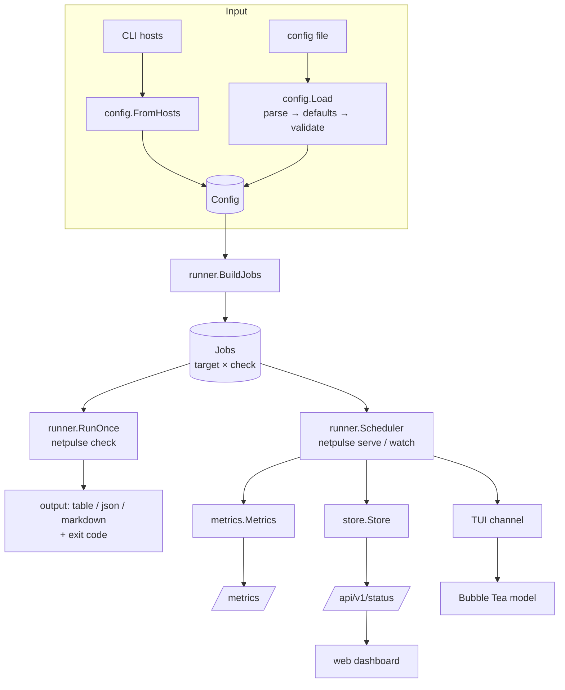
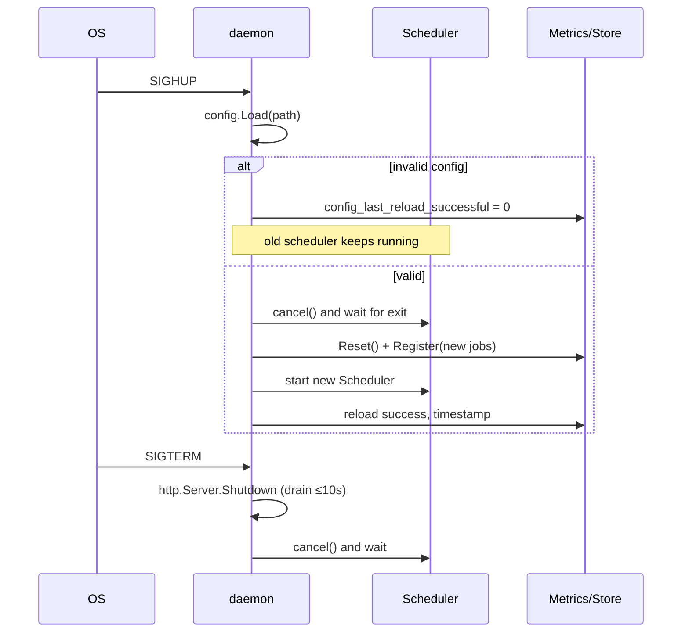

# Architecture

This document explains how NetPulse is put together and, more importantly, *why* each design decision was made.

- [1. Goals and non-goals](#1-goals-and-non-goals)
- [2. High-level design](#2-high-level-design)
- [3. The check model](#3-the-check-model)
- [4. The four checkers](#4-the-four-checkers)
- [5. Concurrency](#5-concurrency)
- [6. Results fan-out: sinks](#6-results-fan-out-sinks)
- [7. Metrics design](#7-metrics-design)
- [8. The HTTP server and dashboard](#8-the-http-server-and-dashboard)
- [9. Configuration](#9-configuration)
- [10. Process lifecycle: signals, reload, shutdown](#10-process-lifecycle-signals-reload-shutdown)
- [11. Testing strategy](#11-testing-strategy)
- [12. Security considerations](#12-security-considerations)
- [13. Trade-offs and future work](#13-trade-offs-and-future-work)

---

## 1. Goals and non-goals

**Goals**

1. Answer *"is this host healthy from where I'm standing?"* across the layers where things actually break: name resolution, transport, TLS and application.
2. Check many hosts **concurrently** with predictable resource use.
3. Be useful in three settings with one binary: an engineer's terminal, a CI/cron job, and long-running monitoring.
4. Speak the standard observability language (Prometheus) instead of inventing a storage or alerting system.
5. Be operable: strict config validation, hot reload, health probes, structured logs, graceful shutdown, small hardened container.

**Non-goals**

- Long-term storage, alert routing or notification delivery. Prometheus, Alertmanager and Grafana already do these well.
- Distributed/multi-location probing. Run several instances in different regions and let Prometheus label them.
- Arbitrary scripted checks. NetPulse focuses on network-layer health.

## 2. High-level design



Packages and their single responsibilities:

| Package | Responsibility | Depends on |
|---|---|---|
| `internal/checks` | Perform one probe, return a `Result` | stdlib, `miekg/dns` |
| `internal/config` | Parse/default/validate YAML; build config from CLI hosts | `yaml.v3`, `miekg/dns` (type names) |
| `internal/runner` | Turn config into jobs; execute them concurrently | `checks`, `config` |
| `internal/metrics` | Map results to Prometheus metrics | `checks`, `client_golang` |
| `internal/store` | Keep latest result + history for UI/API | `checks` |
| `internal/server` | HTTP routes, middleware, embedded dashboard | `store` |
| `internal/output` | Render results for terminals/CI; exit codes | `checks`, `lipgloss` |
| `internal/tui` | Live terminal UI | `checks`, `runner`, `output`, Bubble Tea |
| `internal/cli` | Cobra commands wiring everything | everything |

Dependencies point one way: `checks` knows nothing about config, Prometheus, HTTP servers or terminals. That keeps the core logic easy to test and reuse. Everything lives under `internal/` because this is an application, not a library: Go then forbids other modules from importing these packages, so their APIs can change freely.

## 3. The check model

```go
type Checker interface {
    Kind() Kind                        // dns | http | tls | tcp
    Check(ctx context.Context) Result
}
```

Three deliberate choices:

1. **No `error` return.** For a health checker, "the site is down" is the *expected output*, not an exceptional condition. Encoding every outcome in `Result.Status` (`ok`, `warn`, `fail`) and `Result.Error` means callers never need two code paths. The runner, metrics, store and renderers all handle exactly one type.
2. **Context first.** Every checker takes a `context.Context` and passes it to every network call (`DialContext`, `NewRequestWithContext`, `HandshakeContext`, `ExchangeContext`). That one mechanism provides timeouts, cancellation on Ctrl-C and cancellation on config reload.
3. **Construction validates, `Check` executes.** `NewXChecker(cfg)` parses URLs, record types and addresses once at startup; `Check` only does I/O. Invalid configuration is reported before the first probe runs.

`Status` is an ordered integer (`Unknown < OK < Warn < Fail`), so "the overall status of a target" is simply the maximum of its checks (`checks.Worst`).

`Result` carries common fields (target, latency, summary, error, phases, ordered details) plus an optional typed block per protocol (`HTTPInfo`, `TLSInfo`, `TCPInfo`, `DNSInfo`). The typed blocks feed metrics; the generic `Details` list feeds UIs. A custom `MarshalJSON` emits latencies in milliseconds rather than Go's nanosecond integers.

## 4. The four checkers

### DNS (`internal/checks/dns.go`)

Uses [`github.com/miekg/dns`](https://github.com/miekg/dns), the library behind CoreDNS, rather than `net.Resolver`. The stdlib resolver hides the details that matter for diagnosis: you can't choose the server per query, ask for arbitrary types such as CAA, or see the RCODE (NXDOMAIN and SERVFAIL look identical) or TTLs.

- The server defaults to the first `nameserver` in `/etc/resolv.conf` (read once via `sync.Once`), falling back to `1.1.1.1:53`.
- **UDP loss:** each attempt has a 2s timeout and up to 3 attempts fit inside the check deadline. Without this, a single dropped datagram on a busy home router burned the entire 10s timeout. Only timeouts are retried; a definitive answer such as NXDOMAIN is not.
- **Truncation:** if the `TC` bit is set, the query is retried over TCP (RFC 7766).
- **NODATA vs failure:** a host with no AAAA record returns NOERROR with zero answers. That's normal for one type, but *zero answers across all types* is a failure.
- **IP hosts** automatically get a reverse (PTR) lookup.
- `expect: [...]` asserts that specific values are present, which catches DNS hijacking and records that drift after a migration.

### HTTP (`internal/checks/http.go`)

The interesting part is the **timing breakdown**, collected with `net/http/httptrace` hooks:

```
|-- dns --|-- connect --|-- tls --|-- server (TTFB) --|-- transfer --|
DNSStart  ConnectStart  TLSStart   WroteRequest  GotFirstResponseByte  body read
```

This is what `curl -w` and browser devtools show, and it's what you need to answer *"is it the network, the TLS termination or the application that's slow?"*

- **`DisableKeepAlives: true`** — every probe opens a fresh connection. With pooling, the second run would reuse the socket and report 0 ms for DNS, connect and TLS, hiding exactly what we're measuring.
- **Bounded body read** (`io.LimitReader`, 1 MiB) — needed for `body_contains` and transfer timing, while making it impossible for a target to exhaust memory.
- **Redirects** are followed up to 10 by default (`follow_redirects: false` returns the 3xx as-is). Trace hooks fire per hop, so phases describe the final request while total latency covers the whole chain.
- Default success is any 2xx/3xx; `expect_status` narrows it.
- A `Host` header override sets `req.Host`, since Go ignores `Host` in `req.Header`.
- `*url.Error` prefixes (`Get "https://…":`) are stripped because the URL is already shown.

### TLS (`internal/checks/tls.go`)

The key insight: **perform the handshake with `InsecureSkipVerify: true`, then verify the chain manually.**

If you let `crypto/tls` verify during the handshake, an expired or self-signed certificate aborts the connection and you learn nothing beyond "handshake failed". By skipping verification during the handshake we can *always* read `PeerCertificates`, then run `x509.Certificate.Verify` with the presented intermediates and the expected hostname. This reports trust and expiry independently:

| Situation | Reported as |
|---|---|
| expired | `EXPIRED 4203d ago (2015-04-12)` |
| self-signed / missing intermediate | `certificate signed by unknown authority…` |
| hostname not in SANs | `certificate not valid for "wrong.host…"` |
| expires within `crit_days` / `warn_days` | fail / warn |
| negotiated TLS < 1.2 | warn |

No application data is ever sent over the unverified connection, so skipping verification during the handshake is safe here.

**Earliest expiry in the chain**, not just the leaf. Intermediates expire too: the Let's Encrypt *DST Root CA X3* expiry in September 2021 broke many clients even though leaf certificates were valid. `days_left` and the metric use the minimum `NotAfter` across the presented chain.

Connect and handshake are timed separately (a manual `net.Dialer` followed by `tls.Client(...).HandshakeContext`). A `ca_file` option supplies a private CA for internal PKI; the tests use this to drive a throwaway CA.

### TCP latency (`internal/checks/tcp.go`)

A "TCP ping": time `N` sequential `connect()` calls and report min / avg / max / jitter / loss.

**Why not ICMP?** Sending ICMP echo needs a raw socket (root or `CAP_NET_RAW`), or unprivileged ping sockets enabled via the `net.ipv4.ping_group_range` sysctl. Many networks and cloud providers also filter ICMP. A SYN → SYN/ACK round trip needs no privileges, works in a locked-down distroless container as a non-root user, and travels the same path as real traffic to the service port.

- DNS is resolved **once** up front so each sample measures only the handshake; DNS has its own check.
- IPv4 is preferred when both families exist: many hosts publish AAAA records while the probing machine has no working IPv6 route, which would look like 100% loss.
- Jitter is the standard deviation of the samples (what `ping` calls `mdev`).
- **SYN retransmission detection:** Linux and macOS use a 1s initial retransmission timeout (RFC 6298). A sample of about 1s or more next to fast samples almost always means a lost SYN that the kernel silently retransmitted: packet loss hidden inside a "successful" connect. NetPulse calls this out explicitly. It was discovered while testing on a congested home network.

## 5. Concurrency

### One-shot: `RunOnce` — bounded parallelism with a semaphore

```go
sem := make(chan struct{}, concurrency)   // counting semaphore
for i, job := range jobs {
    wg.Go(func() {
        sem <- struct{}{}                  // acquire (or bail on ctx.Done)
        defer func() { <-sem }()           // release
        results[i] = Execute(ctx, job)     // each goroutine owns index i: no mutex
    })
}
wg.Wait()
```

- One goroutine per job is cheap (a few KiB of stack). The **semaphore** bounds the expensive part: sockets, file descriptors and outbound bandwidth.
- Results are written to a pre-sized slice by index, so output order is deterministic (config order) and no lock is needed: each goroutine writes a distinct element.
- `sync.WaitGroup.Go` (Go 1.25) removes the classic `Add`/`Done` mismatch bug.
- Because of the semaphore, wall-clock time is about `ceil(N / concurrency) × typical latency`. The test suite asserts both the upper bound on parallelism and that parallelism actually happens.

### Continuous: `Scheduler`

Each job gets its **own goroutine and `time.Ticker`**, and all share one semaphore.

Why not a central priority queue (min-heap of next-run times)? Per-job goroutines are simpler, naturally support a different interval per target, and scale to thousands of jobs: an idle goroutine blocked on a channel costs only its stack. A heap becomes worthwhile around hundreds of thousands of jobs, which is beyond this tool's scope.

Two details prevent self-inflicted problems:

1. **Start-up jitter.** Each job sleeps a random offset (up to `min(interval, 2s)`) before its first run. Without it, 500 targets would fire in the same millisecond every interval (a *thundering herd*), causing self-inflicted latency spikes and bursty load on resolvers.
2. **No backlog.** `time.Ticker` drops ticks if the receiver is busy, so a check slower than its interval never accumulates a queue of overdue runs. Config validation also enforces `timeout <= interval`.

`Ready()` returns true once every job has completed at least once (an `atomic.Int64` counter). It backs `/readyz`, so a load balancer or Kubernetes doesn't route to an instance whose metrics are still incomplete.

`TriggerAll()` (the TUI's `r` key) does a non-blocking send to a channel that a fan-out goroutine broadcasts to per-job buffered channels of size 1, so repeated presses coalesce instead of piling up.

### `Execute`: timeout and fault isolation

```go
ctx, cancel := context.WithTimeout(ctx, job.Timeout)
defer cancel()
defer func() { if p := recover(); p != nil { res = failed("check panicked") } }()
return job.Checker.Check(ctx)
```

- The per-check deadline is enforced by context, so it propagates into every network call.
- A panic in one checker (a bug, or a nil pointer from an unexpected server response) becomes a failed `Result` instead of crashing the daemon and taking every other check down with it.
- Timeout errors from deep inside libraries (`i/o timeout`, `context deadline exceeded`) are normalised to `timed out after 10s`.

### Thread-safety summary

| Shared state | Protection |
|---|---|
| `RunOnce` results slice | disjoint indices: no lock |
| `store.Store` | `sync.RWMutex`: many dashboard readers, short writer critical sections; `Snapshot()` deep-copies so JSON encoding happens outside the lock |
| Prometheus vectors | internally synchronised by `client_golang` |
| Scheduler readiness | `atomic.Int64` |
| Daemon scheduler swap (reload) | `sync.Mutex` |
| TUI model | owned by Bubble Tea's event loop; results arrive as messages over a channel, so there are no locks at all |

CI runs the tests with `-race`, including a dedicated concurrent store test.

## 6. Results fan-out: sinks

```go
type Sink interface { Observe(checks.Result) }
```

The scheduler doesn't know who consumes results. `serve` passes the metrics and the store; `watch` passes a `SinkFunc` that forwards into a channel read by the TUI. Adding a webhook notifier later would just be one more sink. This is the observer pattern; `SinkFunc` uses the same adapter idiom as `http.HandlerFunc`.

## 7. Metrics design

See [METRICS.md](METRICS.md) for the full catalogue. The principles:

- **Private registry** (`prometheus.NewRegistry()`), not the global default: no hidden global state, tests can create many instances, and `/metrics` contains exactly what we register (plus explicitly added Go runtime and process collectors).
- **Conventions:** `netpulse_` namespace, base units (seconds), `_total` counters, `_timestamp_seconds` for points in time, `_ratio` for 0–1 values, and a `build_info` gauge with version labels.
- **State set for status:** `netpulse_check_status{status="ok|warn|fail"}` has exactly one series at 1. That makes `sum by (status)` and `== 1` queries natural, unlike magic numbers (0/1/2) in a single gauge.
- **Timestamps, not countdowns:** cert expiry is exported as an absolute Unix timestamp; "days left" is computed in PromQL (`(x - time()) / 86400`). A countdown gauge would be stale between scrapes; a timestamp is always correct.
- **Histogram + last-value gauge:** the histogram (`check_duration_seconds`) allows aggregation and percentiles across time and targets; the gauge (`check_latency_seconds`) gives the "current value" that dashboards want.
- **Bounded cardinality:** every label value comes from config (`target`, `group`, `check`, `phase`, DNS `type`) or a fixed set (`status`, `stat`), never from response data such as URLs, IPs or error strings. Series count is therefore `O(targets × checks)` and fully under the operator's control.
- **No stale series:** on config reload `Reset()` clears all per-target vectors, so removed targets disappear instead of reporting their last value forever. DNS record-type series use `DeletePartialMatch` per target, so a removed AAAA record stops being reported.

## 8. The HTTP server and dashboard

Routes use Go 1.22+ `ServeMux` patterns, so method matching (`GET /metrics`, giving a 405 for POST) and exact-match roots (`GET /{$}`) need no third-party router.

| Route | Purpose |
|---|---|
| `/` + `/assets/` | dashboard, embedded with `//go:embed web` |
| `/metrics` | `promhttp.HandlerFor(registry, {EnableOpenMetrics: true})` |
| `/healthz` | liveness: the process is serving |
| `/readyz` | readiness: every check has reported (503 before that) |
| `/api/v1/status` | JSON snapshot used by the dashboard |
| `/api/v1/version` | build info |

**Middleware** (outermost first): panic recovery (re-panicking `http.ErrAbortHandler` per the net/http contract) → request logging with a status-capturing `ResponseWriter` that implements `Unwrap()` → security headers.

**Server timeouts** (`ReadHeaderTimeout`, `ReadTimeout`, `WriteTimeout`, `IdleTimeout`) are set explicitly; Go's zero values mean "no timeout", which leaves a server open to slow-loris connection exhaustion.

**Liveness vs readiness.** Liveness failing means "restart me"; readiness failing means "don't send me traffic yet". Mixing them up causes restart loops during slow start-ups.

**The dashboard** is dependency-free HTML/CSS/JS, embedded in the binary so there's nothing to deploy separately and it works offline. It polls `/api/v1/status` every 5s; polling was chosen over SSE/WebSockets because it is robust behind any proxy, stateless on the server, and 5s is plenty for health data. All text goes in through `textContent`, never `innerHTML`: summaries and error strings come from remote servers and must be treated as untrusted input (XSS). A strict `Content-Security-Policy` (`default-src 'self'`) works because nothing loads from third parties. Element widths are set through the CSSOM (`el.style.width`), which CSP permits, rather than inline `style` attributes, which it blocks. It supports light/dark themes via `prefers-color-scheme` and honours `prefers-reduced-motion`.

## 9. Configuration

Parsing pipeline: **read → `os.ExpandEnv` → strict YAML decode → `ApplyDefaults` → `Validate`**.

- `${VAR}` expansion keeps secrets (auth headers) out of the file, which fits Kubernetes Secrets and systemd `EnvironmentFile`.
- `KnownFields(true)` makes unknown keys an error. A typo like `expect_staus: [200]` would otherwise be silently ignored, leaving a check weaker than its author believes.
- **Presence enables a check**: `tls: {}` turns TLS on with defaults. The config uses pointer types (`*TLSCheck`) to tell "absent" from "present but empty". `FollowRedirects *bool` uses the same trick so that "unset" and `false` stay distinguishable.
- **Defaults are applied once**, so the rest of the program never handles zero values.
- **Validation collects every error** (`errors.Join`) with a path prefix (`targets[2] (github): http.url: …`), so a broken file can be fixed in one pass.
- A custom `Duration` type implements `yaml.Unmarshaler` so durations are written as `"30s"`.

`config.FromHosts` builds the same `Config` structure from CLI arguments, so quick mode and file mode share every later code path.

## 10. Process lifecycle: signals, reload, shutdown



- **Reload is transactional:** the new config is parsed *and* turned into jobs before the old scheduler is touched, so a bad edit never takes monitoring down. Failure is visible in a metric that has an alert rule.
- **Ordering matters:** the old scheduler must fully stop *before* metrics are reset; otherwise an in-flight result could recreate a series for a removed target just after the reset.
- **Graceful shutdown:** `signal.NotifyContext` turns SIGINT/SIGTERM into context cancellation. `http.Server.Shutdown` stops accepting connections and waits up to 10s for in-flight scrapes, then the scheduler stops. In-flight checks are cancelled through their contexts; cancelled results are not published, which avoids a burst of spurious failures at shutdown.
- `systemctl reload netpulse` maps to `ExecReload=/bin/kill -HUP $MAINPID`, the same convention as nginx, sshd and Prometheus.

## 11. Testing strategy

The suite runs **fully offline and deterministically**:

| What | How |
|---|---|
| DNS | in-process `miekg/dns` server on `127.0.0.1:0` with a tiny zone (A, CNAME, PTR, NXDOMAIN, NODATA) |
| TLS | a throwaway ECDSA certificate authority generated in the test; leaf certs with chosen `NotAfter` exercise ok/warn/crit/expired; wrong SAN and untrusted root cases too |
| HTTP | `httptest.Server` / `NewTLSServer`: status/body assertions, redirects, headers, timeouts, the 1 MiB cap and the phase breakdown |
| TCP | a local listener, and a closed port for refusals |
| Runner | fake checkers that record peak concurrency (atomic compare-and-swap), sleep or panic |
| Metrics | `prometheus/testutil.ToFloat64` and `CollectAndCount`, including stale-series removal |
| Server | `httptest.NewRecorder` over the real router, plus a real listener for graceful shutdown |
| TUI | drive `Update` with synthetic messages and assert on `View()` |
| CLI | the real Cobra tree run in-process with injected args and writers, asserting exit codes and JSON |

Table-driven tests are used throughout. CI runs them with `-race` on Linux, macOS and Windows.

## 12. Security considerations

- **No SSRF surface:** targets come only from the operator's config. There is deliberately no `/probe?target=` endpoint, because on a publicly hosted instance that would turn NetPulse into an open proxy and port scanner.
- **Read-only HTTP API**: no mutating endpoints, and config reload is via signal only.
- **Least privilege:** distroless, non-root (uid 65532), read-only root filesystem, all capabilities dropped. The TCP-ping design means no `CAP_NET_RAW`. The systemd unit uses `DynamicUser`, `ProtectSystem=strict`, an empty `CapabilityBoundingSet` and a syscall filter.
- **Untrusted remote data** is size-capped (1 MiB bodies), never used as metric labels, and rendered with `textContent` in the browser.
- `InsecureSkipVerify` is used in exactly two places: the TLS checker, where verification is done manually afterwards and no data is exchanged, and the opt-in `insecure_skip_verify` HTTP option. Both are annotated for `gosec`.

## 13. Trade-offs and future work

| Decision | Trade-off |
|---|---|
| Goroutine per job | trivial code, fine up to many thousands of jobs; a heap scheduler would scale further |
| In-memory history | no persistence across restarts, by design: Prometheus is the long-term store |
| Polling dashboard | up to 5s staleness; SSE would be live but needs proxy-friendly keep-alive handling |
| TCP instead of ICMP | measures the service path without privileges, but doesn't help hosts with no open TCP ports |
| Phases from the last redirect hop | simple and usually what you want; per-hop timing would need a richer data model |

Possible next steps: an opt-in ICMP checker, DNSSEC validation and DoH resolvers, a blackbox-style `/probe` endpoint behind an allowlist, webhook notifications as a new `Sink`, and Prometheus native histograms.
